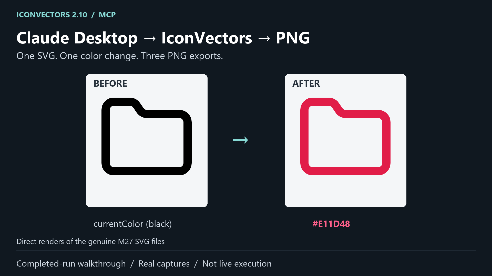
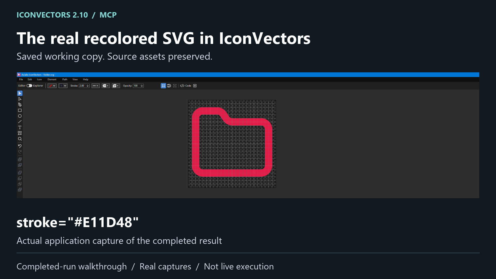
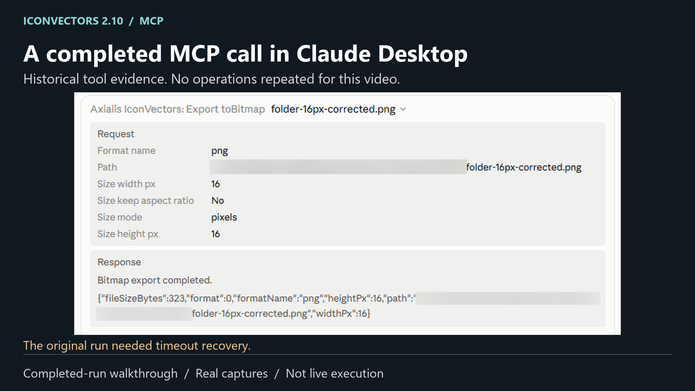
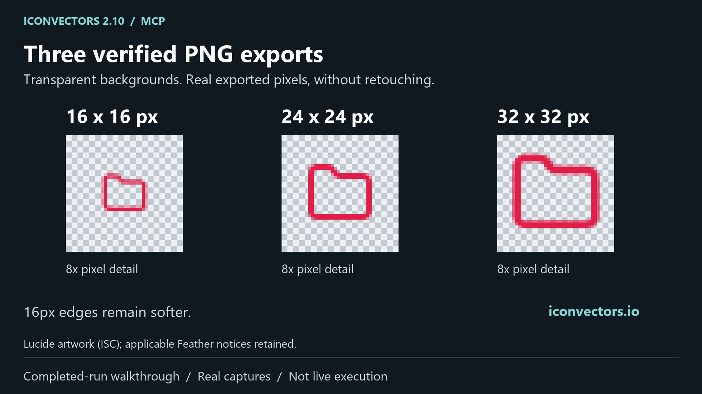

# IconVectors: AI-assisted SVG editing, visible results

One folder icon, one color change, three PNG sizes. This completed Windows workflow connects Claude Desktop to IconVectors, a commercial native SVG editor, while keeping the source and exported results available for inspection.

[Watch the existing 40-second walkthrough](media/claude-desktop-iconvectors-walkthrough.mp4) / [Read the technical walkthrough](claude-desktop-walkthrough.md)

The video is an edited presentation of a completed run, not continuous live execution or a speed benchmark.

## From source to result

Direct renders of the [preserved source SVG](../examples/claude-desktop-walkthrough/source/folder.svg) and [saved result](../examples/claude-desktop-walkthrough/result/folder.svg). The stroke changes from `currentColor` to `#E11D48`.

## Inside the native editor

The saved recolored SVG in IconVectors 2.10 on Windows, shown in an authentic application capture.

## An inspectable MCP export

This real Claude panel shows the **PNG export**, not the stroke-edit command. The original run required timeout recovery and corrected export arguments, documented in the technical walkthrough.

## Three actual PNG exports

Transparent exports at [16 px](../examples/claude-desktop-walkthrough/png/folder-16px.png), [24 px](../examples/claude-desktop-walkthrough/png/folder-24px.png) and [32 px](../examples/claude-desktop-walkthrough/png/folder-32px.png). The smaller output retains softer edges; this is not a pixel-perfect rendering claim.

## About the creator

Marc EMILE is the founder of AXIALIS, a France-based software company developing creative tools for icon and vector design.

[IconVectors](https://iconvectors.io) / [AXIALIS](https://www.axialis.com)

## Credits and scope

Folder artwork: Lucide, under ISC with applicable Feather MIT notices. AXIALIS does not claim authorship of the original icon. [Asset provenance](../examples/claude-desktop-walkthrough/NOTICE.md) and [complete original license notices](../examples/claude-desktop-walkthrough/licenses/lucide-LICENSE.txt) remain unchanged. Application interfaces and trademarks retain their respective rights.

This example documents one Windows / Claude Desktop / IconVectors combination; it does not establish compatibility with every MCP client.
